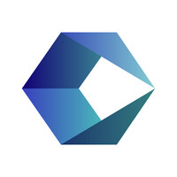
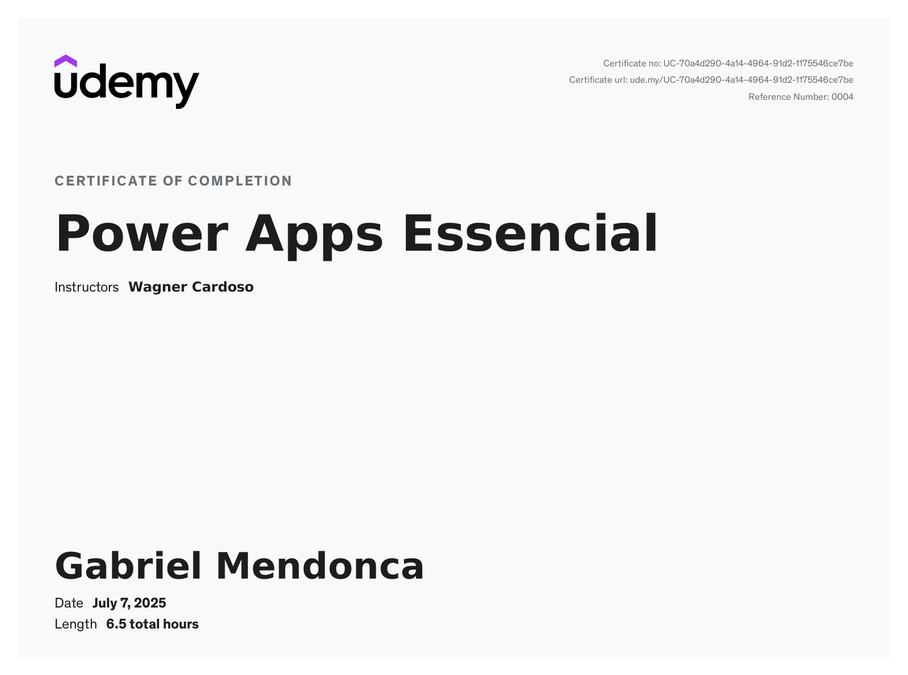
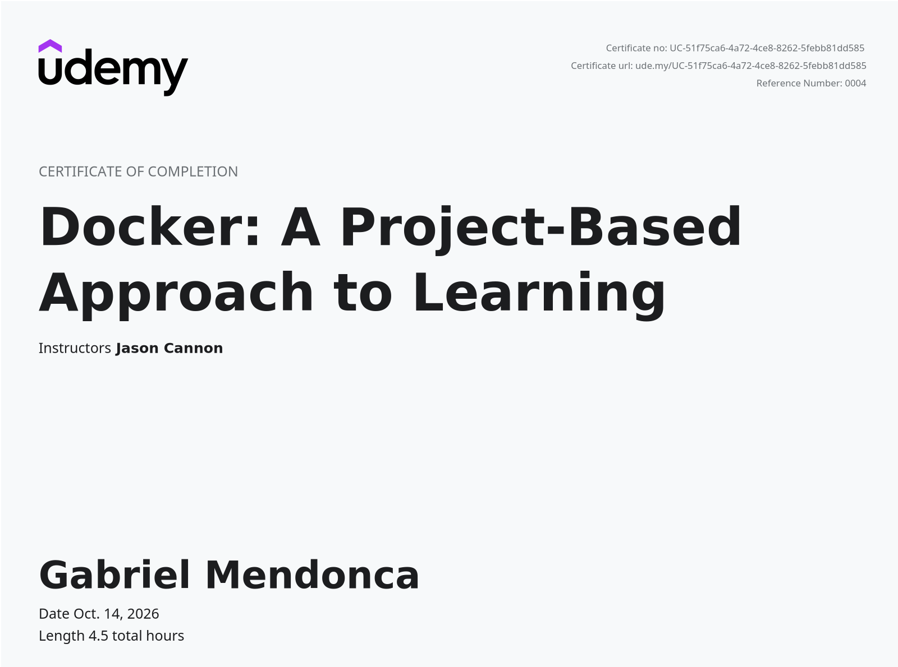

<!-- Profile header -->
  <table width="100%">
    <tr>
      <td width="75%">
          
      </td>
      <td width="25%">
          
      </td>
    </tr>
  </table>
<!-- Profile content -->

  <!-- Technologies and tools -->
  <table width="100%">
    <tr align="center">
      <td colspan="2">
        
        
        
        
        
        
        
        <!--  -->
        <!--  -->
           
        
        
        
        
         
        
           
        
        
        
        
        
           
        
        
        
        
        
           
        
        
           
        
          &nbsp;&nbsp;&nbsp;&nbsp;&nbsp;&nbsp;
        
        
        
        
        <!--  -->
      </td>   
    </tr>
    <tr width="100%" align="center">
      <td colspan="2" align="center">
        
 
            
            
            
        

      </td>
    </tr>
  </table>
     
  <!-- Work experience -->
  <table width="100%">
    <tr>
        <th colspan="2">🖥️ Work experiences in the technology field</th>
        <th class="column-title">💼 Work experiences in other areas</th>
    </tr>
    <tr>
       <td>
            
        </td>
        <td>
            
        </td>
        <td>
            
        </td>
    </tr>
    <tr>
      <td>
Exp. Time: 1 year and 7 mth's
</td>
      <td>
Exp. Time: 1 year and 7 mth's
</td>
      <td>
Exp. Time: 1 year and 6 mth's
</td>
    </tr>  
    <tr>
        <td><strong>Bilingual Service Desk Agent</strong>   • Night-Shift 12x36</td>
        <td><strong>Service Desk Analyst N1</strong>   • Full-time (Forty hours per week)</td>
        <td><strong>Local Tech Salesperson Leader</strong>   • Full-time (Forty-four hours per week)</td>
    </tr>
    <tr>
        <td>Main Tools Used: <code>Powershell</code>, <code>Service Now</code> , <code>Azure Cloud Entry ID</code> , <code>Active Directory</code> , <code>Microsoft O365</code> , <code>Microsoft W11</code> ,
        <code>Microsoft SCCM</code> ,  <code>Power Automate</code> 
        </td>
        <td>Main Tools Used: <code>Powershell</code>, <code>Microsoft SCCM</code> , <code>Notion</code>, <code>Microsoft O365</code>, <code>Azure Account Services</code>, <code>Remote Access</code></td>
        <td>Main Tools Used: <code>Microsoft Teams</code>, <code>Consultive Sales</code>, <code>Targets Management</code></td>
    </tr>
    <tr>
        <td>Most used Soft Skills: <code>Active English (Call,Mail,Chat) Handling</code> , <code>Active Communication</code>, <code>Troubleshooting</code>, <code>Customer/user service</code></td>
        <td>Most used Soft Skills: <code>Active Communication</code>, <code>Troubleshooting</code>, <code>Customer/user service</code></td>
        <td>Most used Soft Skills: <code>Active Communication</code>, <code>Customer/user service</code>, <code>Mobile Hardware Consultancy</code></td>
    </tr>
    <tr>
        <td>Development Opportunities: <code>Daily English practice</code>, <code>Company UDEMY</code>, <code>Agent chosen for eventual Power Automate flow maintenances </code></td>
        <td>Development Opportunities: <code>Speexx English B1</code>, <code>Atos MyLearning Courses Portal</code>, <code>7° UFN-Atos Java Academy</code></td>
        <td>Development Opportunities: <code>Retail sales knowledge</code></td>
    </tr>
  </table>
     

<!-- Courses and certifications -->
<h2 align="center">🎓 Courses &amp; Certifications</h2>

  Courses grouped by learning platform, with the main technologies and concepts covered by each program.

<table id="courses-other-sources" width="100%">
  <tr>
    <th colspan="5">Other Sources · certificates</th>
  </tr>
  <tr align="center">
    <td width="20%" valign="top">
      
       
      <strong>7th UFN Java Academy</strong>
       
      Professional Java fundamentals academy
        
      <code>Java</code> <code>Backend</code>
        
      <a href="Assets/Certificates/Other%20Sources/Certificado_Setima_Academia_Java_UFN.pdf">View certificate ↗</a>
    </td>
    <td width="20%" valign="top">
      
       
      <strong>+PraTi Program</strong>
       
      Technology training program
        
      <code>Technology</code> <code>Professional Training</code>
        
      <a href="Assets/Certificates/Other%20Sources/MaisPraTi.jpg">View certificate ↗</a>
    </td>
    <td width="20%" valign="top">
      
       
      <strong>Cognizant Diversability</strong>
       
      Professional development program
        
      <code>Inclusion</code> <code>Technology</code>
        
      <a href="Assets/Certificates/Other%20Sources/cognizant-diversability.jpeg">View certificate ↗</a>
    </td>
    <td width="20%" valign="top">
      
       
      <strong>Avanti Bootcamp 2026</strong>
       
      Technology bootcamp
        
      <code>Technology</code> <code>Bootcamp</code>
        
      <a href="Assets/Certificates/Other%20Sources/avanti-2026.pdf">View certificate ↗</a>
    </td>
    <td width="20%" valign="top">
      
       
      <strong></strong>
       
      
        
      <code>Training</code>
        
      <!-- <a href="Assets/Certificates/Other%20Sources/avanti-2026.pdf">View certificate ↗</a> -->
    </td>
  </tr>
  <tr align="center">
    <td width="20%" valign="top">
      
       
      <strong></strong>
       
      
        
      <code>Training</code>
        
      <!-- <a href="Assets/Certificates/Other%20Sources/avanti-2026.pdf">View certificate ↗</a> -->
    </td>
    <td width="20%" valign="top">
      
       
      <strong></strong>
       
      
        
      <code>Training</code>
        
      <!-- <a href="Assets/Certificates/Other%20Sources/avanti-2026.pdf">View certificate ↗</a> -->
    </td>
    <td width="20%" valign="top">
      
       
      <strong></strong>
       
      
        
      <code>Training</code>
        
      <!-- <a href="Assets/Certificates/Other%20Sources/avanti-2026.pdf">View certificate ↗</a> -->
    </td>
    <td width="20%" valign="top">
      
       
      <strong></strong>
       
      
        
      <code>Training</code>
        
      <!-- <a href="Assets/Certificates/Other%20Sources/avanti-2026.pdf">View certificate ↗</a> -->
    </td>
    <td width="20%" valign="top">
      
       
      <strong></strong>
       
      
        
      <code>Training</code>
        
      <!-- <a href="Assets/Certificates/Other%20Sources/avanti-2026.pdf">View certificate ↗</a> -->
    </td>
  </tr>
</table>

 

<table id="courses-dio" width="100%">
  <tr>
    <th colspan="5">Digital Innovation One · bootcamps</th>
  </tr>
  <tr align="center">
    <td width="20%" valign="top">
      
       
      <strong>Microsoft Azure AI Fundamentals</strong>
       
      Cloud and artificial intelligence fundamentals
        
      <code>Azure</code> <code>AI-900</code> <code>Cloud</code>
        
      <a href="Assets/Certificates/Digital%20Inovation%20One/Bootcamp%20Azure%20AI900/Microsoft%20Azure%20AI%20Fundamentals.pdf">View certificate ↗</a>
    </td>
    <td width="20%" valign="top">
      
       
      <strong>Riachuelo Java Bootcamp 2025</strong>
       
      Java development from fundamentals to persistence
        
      <code>Java</code> <code>OOP</code> <code>Git</code> <code>SQL</code>
        
      <a href="Assets/Certificates/Digital%20Inovation%20One/Bootcamp%20Riachuelo%20Java%202025/certificate.jpg">View certificate ↗</a>
    </td>
    <td width="20%" valign="top">
      
       
      <strong>Linux Fundamentals 2025</strong>
       
      Linux system and command-line fundamentals
        
      <code>Linux</code> <code>CLI</code> <code>System Administration</code>
        
      <a href="Assets/Certificates/Digital%20Inovation%20One/Linux%20Fundamentals%202025/certificate.png">View certificate ↗</a>
    </td>
    <td width="20%" valign="top">
      
       
      <strong></strong>
       
      
        
      <code>Training</code>
        
      <!-- <a href="Assets/Certificates/Other%20Sources/avanti-2026.pdf">View certificate ↗</a> -->
    </td>
    <td width="20%" valign="top">
      
       
      <strong></strong>
       
      
        
      <code>Training</code>
        
      <!-- <a href="Assets/Certificates/Other%20Sources/avanti-2026.pdf">View certificate ↗</a> -->
    </td>
  </tr>
</table>

 

<table id="courses-udemy" width="100%">
  <tr>
    <th colspan="5">Udemy · courses</th>
  </tr>
  <tr align="center">
    <td width="20%" valign="top">
      
       
      <strong>Power Apps Essential</strong>
       
      Business application development with Microsoft Power Platform
        
      <code>Power Apps</code> <code>Low-code</code>
        
      <a href="Assets/Certificates/Udemy/powerapps-essencial-wagner-cardoso.jpg">View certificate ↗</a>
    </td>
    <td width="20%" valign="top">
      
       
      <strong>Power Automate Basics</strong>
       
      Workflow automation with Microsoft Power Platform
        
      <code>Power Automate</code> <code>Workflow Automation</code>
        
      <a href="Assets/Certificates/Udemy/powerautomate-basics-marcos-adriani-peres.jpg">View certificate ↗</a>
    </td>
    <td width="20%" valign="top">
      
       
      <strong>Docker Fundamentals</strong>
       
      Core Docker toolkit and how to use Docker Swarm
        
      <code>DevOps</code> <code>Docker</code>
        
      <a href="Assets/Certificates/Udemy/docker-project-based-approach-udemy.png">View certificate ↗</a>
    </td>
    <td width="20%" valign="top">
      
       
      <strong></strong>
       
      
        
      <code>Training</code>
        
      <!-- <a href="Assets/Certificates/Other%20Sources/avanti-2026.pdf">View certificate ↗</a> -->
    </td>
    <td width="20%" valign="top">
      
       
      <strong></strong>
       
      
        
      <code>Training</code>
        
      <!-- <a href="Assets/Certificates/Other%20Sources/avanti-2026.pdf">View certificate ↗</a> -->
    </td>
    <tr>
      <td width="20%" valign="top">
        
         
        <strong></strong>
         
        
          
        <code>Training</code>
          
        <!-- <a href="Assets/Certificates/Other%20Sources/avanti-2026.pdf">View certificate ↗</a> -->
      </td>
      <td width="20%" valign="top">
        
         
        <strong></strong>
         
        
          
        <code>Training</code>
          
        <!-- <a href="Assets/Certificates/Other%20Sources/avanti-2026.pdf">View certificate ↗</a> -->
      </td>
      <td width="20%" valign="top">
        
         
        <strong></strong>
         
        
          
        <code>Training</code>
          
        <!-- <a href="Assets/Certificates/Other%20Sources/avanti-2026.pdf">View certificate ↗</a> -->
      </td>
      <td width="20%" valign="top">
        
         
        <strong></strong>
         
        
          
        <code>Training</code>
          
        <!-- <a href="Assets/Certificates/Other%20Sources/avanti-2026.pdf">View certificate ↗</a> -->
      </td>
      <td width="20%" valign="top">
        
         
        <strong></strong>
         
        
          
        <code>Training</code>
          
        <!-- <a href="Assets/Certificates/Other%20Sources/avanti-2026.pdf">View certificate ↗</a> -->
      </td>
    </tr>
  </tr>
</table>

 

<table id="courses-alura" width="100%">
  <tr>
    <th colspan="5">Alura · certificates</th>
  </tr>
  <tr align="center">
    <td width="20%" colspan="1" valign="top">
      
       
      <strong>Oracle ONE · LLMs with LangChain</strong>
       
      Certificate 1
        
      <code>AI</code> <code>Python</code> <code>LangChain</code> <code>Gemini</code>
        
      <a href="Assets/Certificates/Alura/Alura-Oracle-One-1.pdf">View certificate ↗</a>
    </td>
    <td width="20%" colspan="1" valign="top">
      
       
      <strong>Oracle ONE · LLMs with LangGraph & n8n</strong>
       
      Certificate 2
        
      <code>AI</code> <code>Python</code> <code>LangGraph</code> <code>n8n</code>
        
      <a href="Assets/Certificates/Alura/Alura-Oracle-One-2.pdf">View certificate ↗</a>
    </td>
    <td width="20%" colspan="1" valign="top">
      
       
      <strong>Oracle ONE · RAG with AI agents</strong>
       
      Certificate 3
        
      <code>Front-end</code> <code>Web Development</code>
        
      <a href="Assets/Certificates/Alura/Alura-Oracle-One-3.pdf">View certificate ↗</a>
    </td>
    <td width="20%" valign="top">
      
       
      <strong></strong>
       
      
        
      <code>Training</code>
        
      <!-- <a href="Assets/Certificates/Other%20Sources/avanti-2026.pdf">View certificate ↗</a> -->
    </td>
    <td width="20%" valign="top">
      
       
      <strong></strong>
       
      
        
      <code>Training</code>
        
      <!-- <a href="Assets/Certificates/Other%20Sources/avanti-2026.pdf">View certificate ↗</a> -->
    </td>
  </tr>
  <tr align="center">

  </tr>
</table>

 

<!-- Profile footer -->

  

   
    <!-- 
    
    
    -->
  

  
      <!-- COMMIT SNAKE BY RAFAELA BALLERINI https://www.instagram.com/p/CPjUBhXDNEE/  --->
    <picture width="100%" align="center">
      <source media="(prefers-color-scheme: dark)" srcset="https://raw.githubusercontent.com/Setznagl/Setznagl/output/github-contribution-grid-snake-dark.svg">
      <source media="(prefers-color-scheme: light)" srcset="https://raw.githubusercontent.com/Setznagl/Setznagl/output/github-contribution-grid-snake.svg">
       
    </picture>

